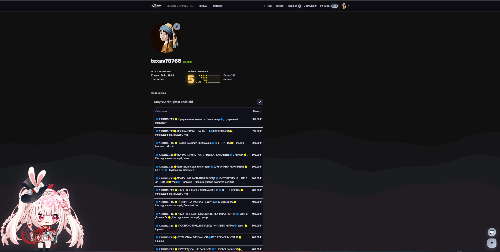
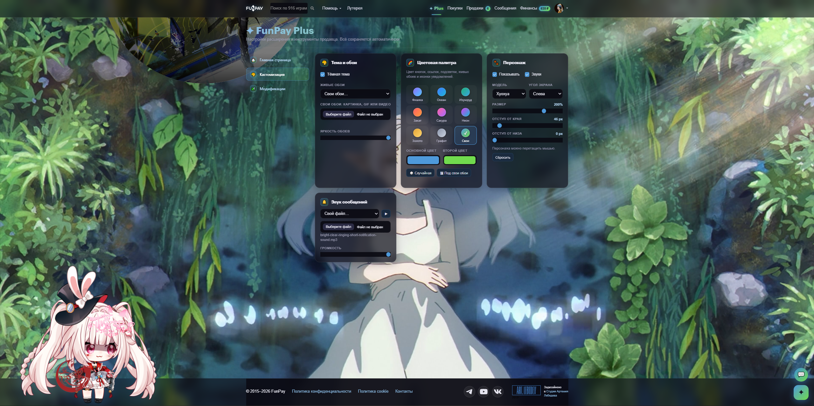
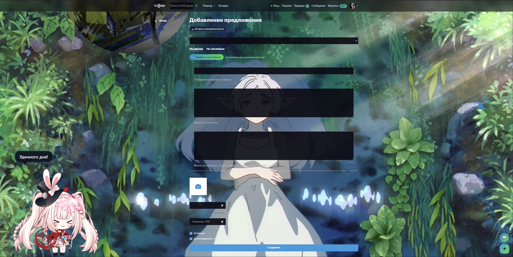
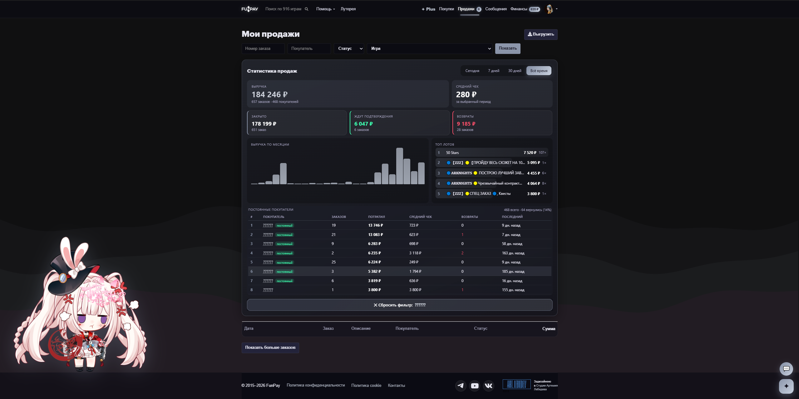
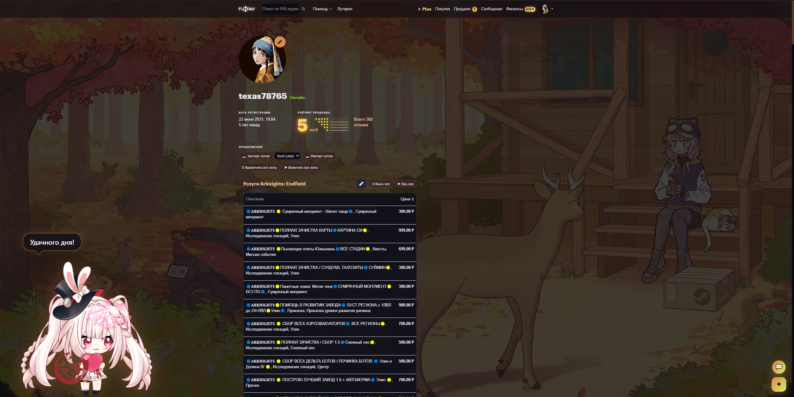

<div align="center">

# ✦ FunPay Plus

**Тёмная тема, живые обои и инструменты продавца для [funpay.com](https://funpay.com)**


[Установка](#-установка) · [Возможности](#-возможности) · [Вопросы](#-частые-вопросы) · [Конфиденциальность](https://hirusanru.github.io/FunPay_Plus/docs/privacy.html)

</div>

> [!NOTE]
> Неофициальное расширение. Не связано с FunPay и не одобрено им.



## ✨ Возможности

### Оформление
- 🌙 **Тёмная тема** для всего сайта
- 🎨 **Цветовые палитры**: выберите акцентный цвет интерфейса
- 🖼️ **Живые обои** с анимированным Live2D-персонажем, который двигается и реагирует. Яркость обоев настраивается.

### Для продавцов
- ⬆️ **Автоподнятие лотов** по расписанию, даже когда вкладка FunPay закрыта
- 🔔 **Уведомления** о новых сообщениях и заказах
- 🔊 **Звук новых сообщений** с регулировкой громкости
- 💬 **Быстрые ответы**: заготовки сообщений, которые вставляются в чат в один клик
- 🌐 **Перевод сообщений** в чате через Google Translate
- 🪟 **Чат во встроенном окне**: переписка открывается без ухода с текущей страницы

Все настройки находятся во всплывающем окне расширения: нажмите на иконку ✦ на панели браузера.

## 🖼️ Скриншоты

<table>
<tr>
<td width="50%"><br><sub>Настройки: тема, обои, палитра, персонаж и звук</sub></td>
<td width="50%"><br><sub>Добавление лота с автопереводом на английский</sub></td>
</tr>
<tr>
<td><br><sub>Статистика продаж и постоянные покупатели</sub></td>
<td><br><sub>Живые обои с Live2D-персонажем и золотой палитрой</sub></td>
</tr>
</table>

## 📦 Установка

### Из Chrome Web Store

Готовится к публикации. Ссылка появится здесь.

### Вручную

1. **Скачайте** [последнюю версию](https://github.com/HiruSanRu/FunPay_Plus/archive/refs/heads/main.zip) и распакуйте архив в удобную папку. Не удаляйте эту папку после установки: браузер загружает расширение прямо из неё.

   Или через git:
   ```bash
   git clone https://github.com/HiruSanRu/FunPay_Plus.git
   ```
2. Откройте страницу расширений:

   | Браузер | Адрес |
   |---|---|
   | Chrome | `chrome://extensions` |
   | Edge | `edge://extensions` |
   | Яндекс Браузер | `browser://tune` |
   | Opera | `opera://extensions` |

3. Включите **Режим разработчика** (переключатель справа вверху).
4. Нажмите **Загрузить распакованное расширение** и выберите папку, в которой лежит `manifest.json`.
5. Закрепите иконку: значок пазла 🧩 на панели → булавка 📌 рядом с FunPay Plus.
6. Откройте [funpay.com](https://funpay.com) или обновите страницу, если она уже была открыта.

### На телефон (Android)

Обычный Chrome на Android расширения не поддерживает, нужен браузер, который умеет их ставить. Проще всего Kiwi Browser.

> Разработку Kiwi Browser остановили в начале 2025 года, но он по-прежнему работает. Если его нет в Google Play, скачайте APK из [официальных релизов на GitHub](https://github.com/kiwibrowser/src.next/releases). Подойдут и другие Chromium-браузеры с поддержкой расширений, например Lemur Browser: шаги там похожие.

1. **Скачайте** [ZIP-архив расширения](https://github.com/HiruSanRu/FunPay_Plus/archive/refs/heads/main.zip) на телефон. Распаковывать не нужно.
2. Откройте в Kiwi адрес `kiwi://extensions`.
3. Включите **Режим разработчика** (Developer mode).
4. Нажмите **+ (from .zip/.crx/.user.js)** и выберите скачанный ZIP.
5. Откройте [funpay.com](https://funpay.com). Настройки FunPay Plus: меню ⋮ → внизу значок расширения, или кнопка Plus в меню сайта.

На телефоне доступно не всё: живые обои и Live2D-персонаж могут тормозить на слабых устройствах, их лучше выключить в «Кастомизации». Автоподнятие работает, только пока браузер открыт.

**Обновление на телефоне:** скачайте новый ZIP, на `kiwi://extensions` удалите старую версию и установите новую тем же способом. Настройки при удалении могут сброситься, поэтому сначала сохраните их: «Главная страница» → «Резервная копия» → «Скачать».

### Обновление

1. Скачайте новую версию и замените файлы в той же папке.
2. На странице расширений нажмите ↻ на карточке FunPay Plus.
3. Обновите вкладки funpay.com.

Настройки при обновлении сохраняются.

## ❓ Частые вопросы

<details>
<summary><b>Расширение не появилось на сайте</b></summary>

Обновите страницу funpay.com (F5). Если не помогло, проверьте на странице расширений, что FunPay Plus включён и под ним нет красной кнопки «Ошибки».
</details>

<details>
<summary><b>При загрузке пишет «Не удалось загрузить манифест»</b></summary>

Вы выбрали не ту папку. Нужна папка, внутри которой сразу лежит `manifest.json`. После распаковки ZIP часто получается вложенная папка `FunPay_Plus-main`, выберите именно её.
</details>

<details>
<summary><b>Не работает автоподнятие лотов</b></summary>

Войдите в аккаунт на funpay.com в этом же браузере. Расширение поднимает лоты от вашего имени, используя текущую сессию. Браузер при этом должен быть запущен, а вкладку сайта держать открытой не нужно.
</details>

<details>
<summary><b>Не приходят уведомления</b></summary>

Разрешите уведомления для браузера в настройках системы: в Windows это «Параметры → Система → Уведомления». Также проверьте, что не включён режим «Не беспокоить».
</details>

<details>
<summary><b>Тормозят живые обои</b></summary>

Анимация Live2D использует видеокарту. На слабых компьютерах отключите живые обои в настройках расширения, остальные функции продолжат работать.
</details>

<details>
<summary><b>Безопасно ли это? Могут ли забанить на FunPay?</b></summary>

Расширение не передаёт ваши данные третьим лицам и работает только внутри вашего браузера. Исходный код открыт, его можно проверить. Автоподнятие отправляет те же запросы, что и кнопка «Поднять» на сайте. Тем не менее это неофициальный инструмент, и вы используете его на свой страх и риск.
</details>

## 🔒 Конфиденциальность

- Работает **только на funpay.com**
- Нет собственного сервера, **ничего не отправляется разработчику**
- Настройки хранятся **в вашем браузере**
- Текст сообщений уходит в Google Translate **только для перевода**

Подробнее в [политике конфиденциальности](https://hirusanru.github.io/FunPay_Plus/docs/privacy.html).

<details>
<summary>Зачем расширению нужны разрешения</summary>

| Разрешение | Для чего |
|---|---|
| `storage` | Хранение ваших настроек |
| `alarms` | Автоподнятие и проверка сообщений по расписанию |
| `cookies` | Проверка входа в аккаунт FunPay для автоподнятия |
| `notifications` | Уведомления о сообщениях и заказах |
| `declarativeNetRequest` | Открытие чата FunPay во встроенном окне |
| `funpay.com` | Работа на сайте |
| `*.googleapis.com` | Перевод сообщений |

</details>

## 🛠️ Для разработчиков

Сборка не нужна: проект состоит из обычных JavaScript-файлов без зависимостей.

```
├── manifest.json       # манифест расширения (MV3)
├── background.js       # фоновый service worker: автоподнятие, уведомления, перевод
├── content.js          # интерфейс на страницах funpay.com
├── content.css         # стили и тёмная тема
├── palette.js          # цветовые палитры
├── sounds.js           # звуки уведомлений
├── mute-site.js        # отключение собственных звуков сайта
├── popup.html / .js    # окно настроек
├── frame-rules.json    # правило для встроенного окна чата
├── lib/                # PixiJS и Live2D Cubism
├── live2d/             # модели Live2D
└── docs/               # политика конфиденциальности
```

После правок нажмите ↻ на карточке расширения и обновите вкладку funpay.com.

Нашли ошибку или есть идея? Создайте [Issue](https://github.com/HiruSanRu/FunPay_Plus/issues).

## 🙏 Благодарности

- [PixiJS](https://pixijs.com)
- [pixi-live2d-display](https://github.com/guansss/pixi-live2d-display)
- [Live2D Cubism SDK](https://www.live2d.com). Модели и Cubism Core распространяются по лицензии Live2D, см. [`live2d/LICENSE.md`](live2d/LICENSE.md).

---

<div align="center">

Связь: [h1iru2702@gmail.com](mailto:h1iru2702@gmail.com)

</div>
